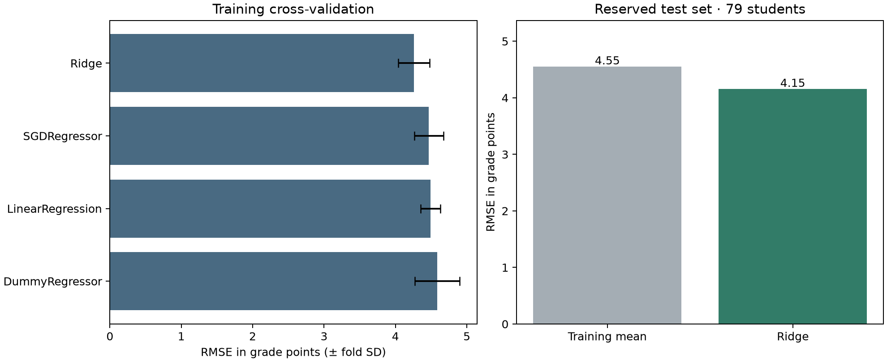

# Student Performance Prediction

A reproducible regression study predicting final mathematics grades on a 0–20 scale.
The revised evaluation uses UCI Student Performance, with 395 rows and a reserved
79-row test set. The notebook was implemented and evaluated with Codex assistance
under Patrick Taylor's direction.

## Results

| Model | Test RMSE | Test MAE | Test R² |
| --- | ---: | ---: | ---: |
| Training-mean baseline | 4.5502 | 3.6459 | -0.0097 |
| Selected Ridge | 4.1535 | 3.3489 | 0.1587 |

Training-only four-fold CV selected Ridge, alpha 100, degree-one numeric features.
Mean validation RMSE was 4.2579. The search compared 19 configurations across a mean
baseline, linear regression, Ridge with degree-one/two numeric features, and SGD
with L1, L2, and Elastic Net penalties. The fixed-model test RMSE bootstrap interval
was approximately 3.48–4.84 grade points. The gain is modest and the residual error
remains substantial.



## Evaluation decisions

- Reserve 20% before tuning, seed 42. All fitting occurs inside training folds.
- Include categorical features with one-hot encoding. Scale numeric features within folds.
- Exclude G1 and G2 to study performance without prior-period grades.
- Exclude cumulative absences because availability at prediction time is unverified.
- Use the mathematics file alone. Students can occur in both subject files.
- Retain the original questionnaire variables for this retrospective benchmark.
  Field collection times, fairness, external schools, and future cohorts require
  separate investigation before any prospective use.
- Select on CV only. Evaluate the locked model and baseline on the reserved test set.
  Error is measured in grade points. Predictions are unclipped.

The test R² of 0.16 and small sample bound the claims this project supports.
Observed associations cannot establish the effect of changing a student's habits.

## Reproduce

Use Python 3.11.

```bash
python3.11 -m venv .venv
source .venv/bin/activate
pip install -r requirements.txt
python run.py
```

The attributed mathematics CSV is included, so execution needs no dataset account.
The runner executes the notebook in a fresh kernel and writes its cell outputs,
all fold scores, test predictions, summary metadata, and chart. Run from a local
environment that permits a Jupyter kernel connection.

## Data and provenance

Cortez, P. (2008). *Student Performance*. UCI Machine Learning Repository.
[Dataset and citation](https://doi.org/10.24432/C5TG7T).
Licensed CC BY 4.0. The included CSV is the unmodified mathematics file.
The original source dictionary is in `data/student.txt`.

CSV SHA256
`e47f9ee225e1ee6e69b7564e6dac7123e80b8486677fe111f351964cef5dec80`

The earlier project used 5,000 synthetic productivity records. Its source CSV was
unavailable during this revision, and its test split followed model selection.
This replacement uses a different dataset and prediction target. Earlier 4.51/4.55
claims have been removed from revised materials. The new baseline's rounded 4.55
is independently computed on the UCI mathematics split.

## Interview discussion

Explain why the holdout comes first, how preprocessing stays inside each fold,
why a baseline matters, and why degree-two features failed to improve the selected
CV score. Be ready to discuss timing assumptions and the remaining error.
